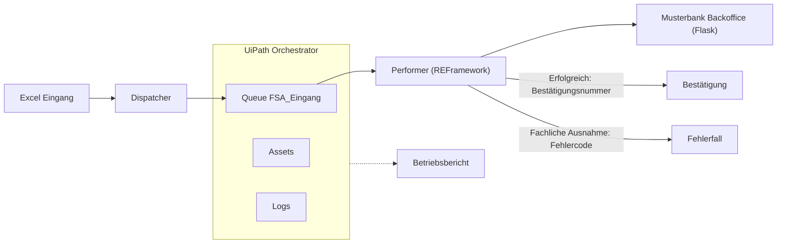

# Musterbank RPA

[](https://github.com/Uditp11/musterbank-rpa/actions/workflows/tests.yml)

## Stand

| Teil | Stand |
|---|---|
| Geschäftsregeln mit Tests (`app/rules.py`) | läuft |
| Testdaten-Generator (`data/`) | läuft |
| Musterbank Backoffice mit Fehlerschaltern (`app/`) | läuft |
| Prozessbeschreibung (`docs/`) | fertig |
| Dispatcher und Performer (`uipath/`) | in Arbeit |
| Störungsläufe mit Protokollen (`docs/stoerungen/`) | in Arbeit |
| Betriebsbericht aus Orchestrator (`monitoring/`) | läuft |

## Was ist das

Ein Lernprojekt: ein erfundenes Bank-Backoffice ("Musterbank Backoffice", eine kleine Flask-Web-App) und ein UiPath-Bot, der Freistellungsaufträge bearbeitet. Der Bot liest eine Excel-Liste, legt jede Zeile in eine Orchestrator-Warteschlange und trägt gültige Aufträge in die Web-App ein. Alle Daten sind synthetisch. Es gibt keine echte Bank und keine echten Kunden.

## Warum

Ich wollte verstehen, wie sich RPA im Betrieb anfühlt: Warteschlangen, Ausnahmen, Störungen und Releases. Darum baue ich nicht nur einen Bot. Ich baue auch die Regeln, die Tests und die Störungen drumherum.

## Ablauf

So soll der fertige Prozess laufen. Der Bot (Schritte 2 bis 6) ist in Arbeit und noch nicht im Repository.

1. Die Fachabteilung liefert eine Excel-Liste mit Freistellungsaufträgen.
2. Der Dispatcher legt jede Zeile als Eintrag in die Warteschlange `FSA_Eingang`.
3. Der Performer (REFramework) holt einen Eintrag und prüft die Geschäftsregeln.
4. Gültige Aufträge trägt er in das Musterbank Backoffice ein und liest die Bestätigungsnummer.
5. Regelverstöße sind fachliche Ausnahmen: kein neuer Versuch, eine Person klärt den Fall.
6. App-Probleme sind Systemausnahmen: Der Eintrag wird automatisch wiederholt.

## Architektur



## Geschäftsregeln

| Regel | Wert |
|---|---|
| Einzelauftrag | höchstens 1.000 EUR |
| Gemeinsamer Auftrag | höchstens 2.000 EUR |
| Steuer-ID | 11 Ziffern, erste Ziffer nicht 0, Ziffernregel und Prüfziffer gültig |
| Gemeinsamer Auftrag | Steuer-ID des Partners nötig |
| Summe mit bestehenden Aufträgen | bleibt im Limit |
| Kunde | muss existieren |

Alle Fehlercodes und die Prüfreihenfolge stehen in [docs/Prozessbeschreibung.md](docs/Prozessbeschreibung.md).

## Schnellstart

```
run_app.bat
```

Dann http://127.0.0.1:5000 öffnen. Login: `sachbearbeiter` / `demo` (Demo-Wert, kein echtes Passwort). Die App ist eine Demo und nur für den lokalen Betrieb gedacht.

In PowerShell heißt der Aufruf `.
un_app.bat`.

Tests ausführen:

```
.venv\Scripts\python -m pytest -q
```

Testdaten neu erzeugen: `.venv\Scripts\python -m data.generate`

- `run_app.bat v2`: startet die App mit umbenanntem Speichern-Button (`APP_VERSION=2`), um eine Störung nachzustellen.
- `run_app.bat slow`: die Bestätigungsseite kommt erst nach 45 Sekunden (`SLOW_CONFIRM=1`), um eine Zeitüberschreitung nachzustellen.

## Betriebsdisziplin

Diese Regeln gelten für den Bot, sobald er im Repository ist:

- Zugangsdaten liegen als Assets in Orchestrator, nie im Code.
- Es gibt getrennte Ordner für Test und Produktion.
- Releases sind versioniert, jede Version hat eine Änderungsnotiz (siehe [CHANGELOG.md](CHANGELOG.md)).
- Vier-Augen-Prinzip: Änderungen kommen über einen Pull Request und werden von einer zweiten Person geprüft.
- Es werden nur synthetische Daten verwendet.

## Nächster Schritt

KI für unstrukturierte Eingänge wie Kundenbriefe: Ein Modell könnte Angaben aus Briefen und Mails lesen und als Vorschlag in die Warteschlange legen. Ein Mensch prüft jeden Vorschlag, bevor etwas gebucht wird. Der Datenschutz kommt zuerst. Das ist eine Idee und noch nicht gebaut.

## English summary

Musterbank RPA is a learning project that models a fictional bank back office process. An Excel list of tax exemption orders (Freistellungsaufträge) is loaded by a UiPath Dispatcher into the Orchestrator queue `FSA_Eingang`. A Performer built on the REFramework validates the business rules and enters valid orders into a local Flask web app, the "Musterbank Backoffice". All data is synthetic, and there is no real bank behind it.

The project shows queue-based processing, the difference between business exceptions (rule violations, no retry) and system exceptions (application problems, with retry), incident handling with written reports, and versioned releases. The Python part (rules, test data, web app, tests) is working. The UiPath bot is in progress.

### Run it

```
run_app.bat
```

Then open http://127.0.0.1:5000 and log in with the demo user `sachbearbeiter` / `demo`.

Run the tests:

```
.venv\Scripts\python -m pytest -q
```

### Repository layout

```
app/                  Flask web app and the business rules (rules.py)
data/                 generate.py: 30 synthetic orders, 6 deliberately invalid
tests/                pytest tests
run_app.bat           starts the web app
uipath/Dispatcher/    loads the Excel list into the queue (in progress)
uipath/Performer/     REFramework bot that processes the queue (in progress)
docs/stoerungen/      incident reports (in progress)
monitoring/           operations reporting (in progress)
```
